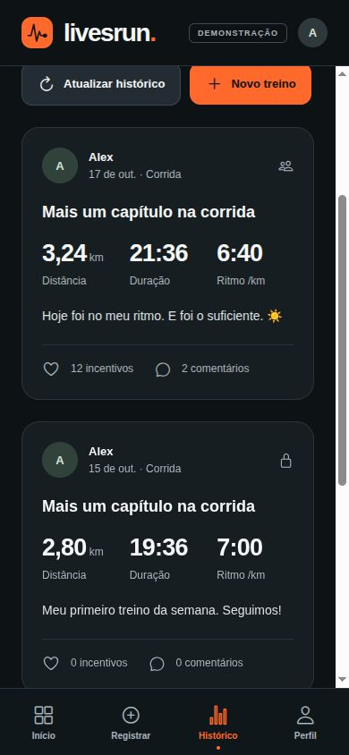

# LivesRun

**Every Move Has a Story.** Cada movimento conta uma história.

MVP navegável para validar a identidade e a experiência da LivesRun. Abre diretamente com dados fictícios em memória, sem cadastro real, chamadas à API ou conexão com banco.

## Executar

Requisitos: Node.js 24 e npm.

```sh
npm ci
npm run dev
```

Prévia: http://localhost:8081

Explore Início, Registrar, Histórico e Perfil. As métricas e atividades mostradas são demonstrativas. O MVP não registra trajetos reais nem salva dados de atletas nesta etapa.

Para abrir o Expo com um cliente de desenvolvimento nativo, use `npm run mobile`. Para gerar a versão web, use `npm run build`.

## Validação

```sh
npm run typecheck
npm test
npm run format:check
```

O backend fica em [iweti/livesrun-api](https://github.com/iweti/livesrun-api). A integração do aplicativo permanece desativada por padrão (`EXPO_PUBLIC_ENABLE_API=false`). Para desenvolvimento com API local, use `apps/mobile/.env.example` como referência. Em aparelho físico, a URL deve ser alcançável pelo dispositivo.

Ao testar a integração, use uma versão da API que ofereça `GET /v1/sync-session`. O app confirma a sessão antes de enviar treinos e mantém a fila local quando perde a conexão. No app nativo, uma sessão verificada e ainda válida permite recuperar o treino salvo mesmo com a API indisponível. Consulte o [contrato HTTP](https://github.com/iweti/livesrun-api/blob/main/docs/api.md) e o [checklist do beta](https://github.com/iweti/livesrun-api/blob/main/docs/beta-checklist.md).

O repositório é privado na organização IWETI. Nenhum banco Neon está conectado ao MVP.



LivesRun © 2026 · Desenvolvido por [IWETI](https://iweti.com).
